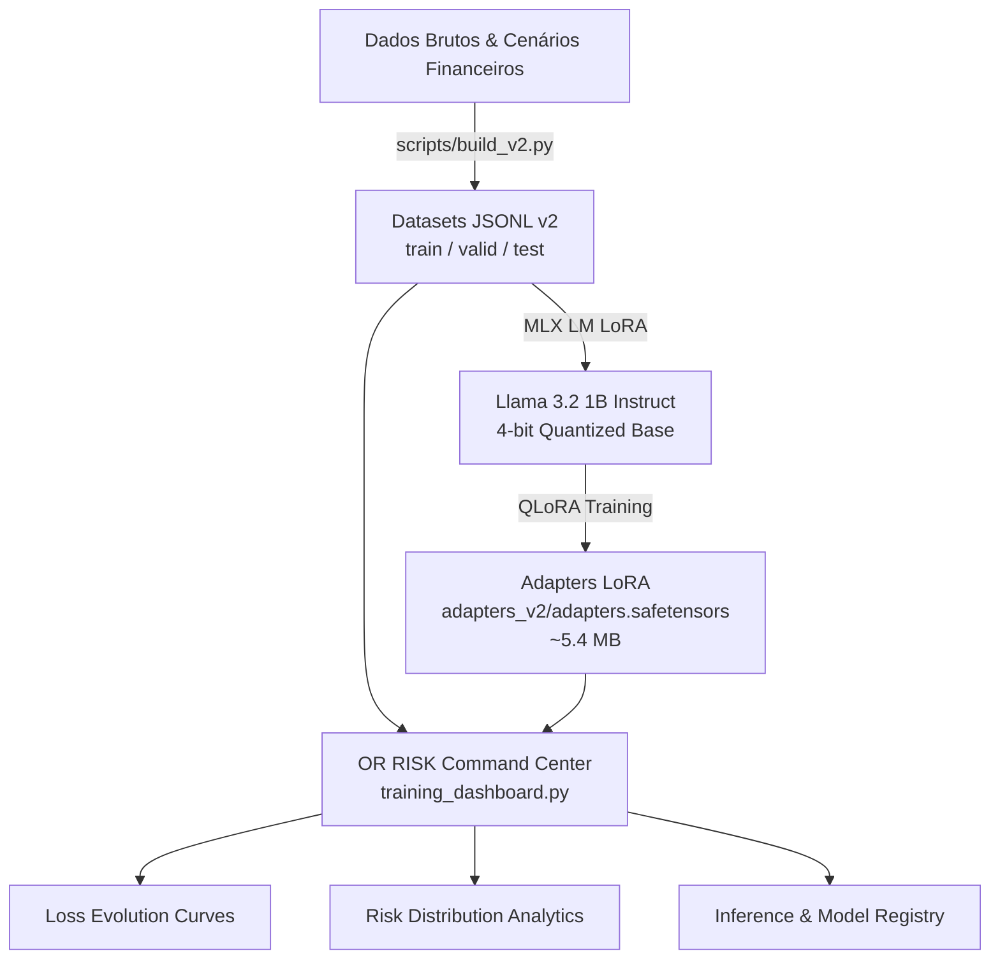

# 🧠 OR-RISK-LLAMA: Financial Risk Intelligence

[](https://huggingface.co/meta-llama/Llama-3.2-1B-Instruct)
[](https://github.com/ml-explore/mlx)
[](https://streamlit.io/)
[](LICENSE)
[](https://developer.apple.com/metal/)

**OR-RISK-LLAMA** é uma plataforma completa de inteligência de risco financeiro baseada em **Llama 3.2 (1B)** com fine-tuning eficiente via **QLoRA (4-bit)** acelerado diretamente em hardware **Apple Silicon** através do framework **Apple MLX**, acompanhado de um **AI Training Command Center** interativo construído em **Streamlit** e **Plotly**.

---

## 🚀 Destaques do Projeto

- **Fine-Tuning com Apple MLX & QLoRA**: Treinamento quantizado em 4-bit (`mlx-community/Llama-3.2-1B-Instruct-4bit`) com apenas **~1.12 GB de pico de memória unificada**.
- **Classificação de Risco Financeiro**: Modelagem contextualizada em cenários de transações com classificação em três níveis: `BAIXO`, `MÉDIO` e `ALTO`.
- **AI Command Center Interativo**: Dashboard de alta fidelidade com acompanhamento em tempo real de curvas de perda (Loss Evolution), distribuição de risco (Risk Distribution), métricas de acurácia e inspeção de dados.
- **Adapters LoRA Leves**: Pesos treinados de LoRA ocupando apenas ~5.4MB, permitindo fácil versionamento e implantação edge em dispositivos macOS / iOS.

---

## 🏗️ Arquitetura do Sistema



---

## 📊 AI Command Center (Dashboard)

O painel de controle oferece visão 360° do ciclo de vida do modelo:
- **Overview & Performance**: Taxa de aprendizado, loss final de treino (`0.005`) e validação (`1.043` - `1.151`), tokens treinados e uso de memória.
- **Loss Evolution**: Comparativo iterativo entre Training Loss e Validation Loss ao longo das 150 iterações.
- **Risk Distribution**: Análise da paridade e balanceamento dos conjuntos de dados por classes de risco.
- **Dataset Intelligence**: Explorador de exemplos de treino e validação com prompts e saídas esperadas.

---

## 📂 Estrutura do Repositório

```text
OR-RISK-LLAMA/
├── adapters/                  # Pesos LoRA da versão inicial
├── adapters_v2/               # Pesos LoRA v2 (treinados com QLoRA 150 iters)
│   ├── adapter_config.json    # Configurações de hiperparâmetros (rank 8, scale 20)
│   └── adapters.safetensors   # Pesos Safetensors (~5.4 MB)
├── data/                      # Datasets de treinamento e validação
│   └── v2/                    # Conjuntos balanceados (train, valid, test)
│       ├── train.jsonl
│       ├── valid.jsonl
│       └── test.jsonl
├── reports/                   # Logs de execução e métricas de treinamento
│   └── train_v2.log           # Log completo de iterações e validações MLX
├── scripts/                   # Scripts auxiliares de pipeline e dados
│   └── build_v2.py            # Gerador e validador de datasets sintéticos
├── .streamlit/                # Configurações visuais e temas do Streamlit
├── requirements.txt           # Dependências do projeto
├── training_dashboard.py      # AI Command Center completo (Streamlit + Plotly)
└── README.md                  # Documentação do projeto
```

---

## 🛠️ Instalação e Execução

### 1. Clonar o Repositório

```bash
git clone https://github.com/maykonlincolnusa/OR-RISK-LLAMA.git
cd OR-RISK-LLAMA
```

### 2. Criar e Ativar Ambiente Virtual

```bash
python3 -m venv .venv
source .venv/bin/activate
pip install --upgrade pip
pip install -r requirements.txt
```

### 3. Executar o AI Command Center (Dashboard)

```bash
streamlit run training_dashboard.py
```
O dashboard estará acessível em `http://localhost:8501`.

---

## ⚡ Treinamento / Fine-Tuning com MLX

Para reproduzir ou treinar novos adaptadores no Apple Silicon:

```bash
python -m mlx_lm.lora \
  --model mlx-community/Llama-3.2-1B-Instruct-4bit \
  --train \
  --data ./data/v2 \
  --adapter-path ./adapters_v2 \
  --iters 150 \
  --batch-size 1 \
  --learning-rate 1e-5 \
  --lora-parameters '{"rank": 8, "scale": 20.0, "dropout": 0.0}' \
  --save-every 100 \
  --steps-per-eval 25 \
  --steps-per-report 5
```

---

## 🔍 Inferência com os Adaptadores

Para testar a inferência diretamente via linha de comando com o modelo base e os adaptadores treinados:

```bash
python -m mlx_lm.generate \
  --model mlx-community/Llama-3.2-1B-Instruct-4bit \
  --adapter-path ./adapters_v2 \
  --prompt "<|begin_of_text|><|start_header_id|>user<|end_header_id|>\n\nAvalie o risco da seguinte operação: Transferência de R$ 95.000 para novo titular em horário incomum.<|eot_id|><|start_header_id|>assistant<|end_header_id|>\n\n" \
  --max-tokens 100
```

---

## 💻 Requisitos de Hardware

- **Sistema Operacional**: macOS 14 (Sonoma) ou superior
- **Arquitetura**: Apple Silicon (M1, M2, M3, M4 - Pro / Max / Ultra / Base)
- **Memória RAM recomendada**: 8 GB+ (consumo no treinamento: ~1.12 GB de memória unificada)

---

## 📄 Licença

Distribuído sob a licença MIT. Consulte `LICENSE` para mais detalhes.
